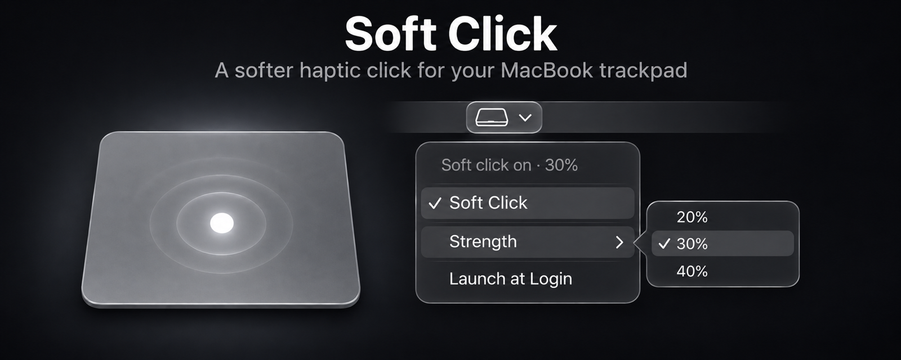

<p align="center">
  
</p>

<p align="center">
  <a href="https://github.com/vivogf/SoftClick/releases/latest"></a>
  
  
  <a href="LICENSE"></a>
</p>

<p align="center">
  <b>A tiny, free and open-source menu bar app for macOS.</b><br>
  Makes the haptic click of your MacBook's Force Touch trackpad softer, from 10% to 100% of the stock strength.
</p>

---

## Why

Even at the *Light* click setting, the built-in Force Touch trackpad gives a firm, loud "thunk" on every press. macOS has no setting to make the click itself weaker. Soft Click plays the same click macOS plays, just quieter. It doesn't change how hard you need to press, and it has no window, no Dock icon and no network access.

## Features

- **The same click, softer.** Soft Click plays the exact press and release pulses macOS uses, at the strength you choose.
- **Strength from 10% to 100%** in 10% steps. 30% is the default; 100% feels like the stock click.
- **Changes apply instantly**, on the next click.
- **Respects your Click pressure setting** (light, medium or firm).
- **Turns itself off safely.** Disabling, quitting, sleep, a locked screen or a crash all bring back the stock click.
- **Launch at login** with one click.
- **Light:** a single small native binary, about 0% CPU while idle.
- **English and Russian** interface.

## Requirements

- macOS 13 Ventura or later
- A MacBook with a built-in **Force Touch** trackpad (2015 and later). The Magic Trackpad keeps its stock click.

## Installation

### Homebrew

```sh
brew tap vivogf/tap
brew trust --cask vivogf/tap/softclick   # Homebrew asks you to trust casks from third-party taps
brew install --cask vivogf/tap/softclick
```

### Download

1. Download **SoftClick.zip** from the [latest release](https://github.com/vivogf/SoftClick/releases/latest).
2. Unzip it and move **SoftClick.app** to **Applications**.
3. Open it. See [First launch](#first-launch) below.

### Build from source

You only need the Xcode Command Line Tools (`xcode-select --install`).

```sh
git clone https://github.com/vivogf/SoftClick.git
cd SoftClick
./build.sh --install   # builds and copies the app to ~/Applications
```

## First launch

1. **Gatekeeper.** The app is free and not notarized by Apple, so the first time macOS says it can't verify the developer. Open **System Settings → Privacy & Security**, scroll down and click **Open Anyway**. (The Homebrew cask skips this step.)
2. **Input Monitoring.** macOS asks to let Soft Click monitor input. Turn it on in **System Settings → Privacy & Security → Input Monitoring**. The app needs it to know when you press and release the trackpad. Until then, you keep the stock click and the menu bar icon shows a warning. If the setting doesn't take effect within a few seconds, quit and reopen Soft Click.

That's it. Look for the  icon in the menu bar and click the trackpad.

## Usage

| Item | What it does |
| --- | --- |
| *Status line* | Shows whether the soft click is on and at what strength, or why it isn't. |
| **Open Input Monitoring Settings…** | Shown only while the permission is missing. |
| **Soft Click** | Turns the soft click on or off. Off means the stock click. |
| **Strength** | 10% to 100% of the stock click, in 10% steps. |
| **Launch at Login** | Starts the app automatically when you log in. |
| **Soft Click on GitHub** | Opens this page. |
| **Quit Soft Click** | Quits and brings back the stock click. |

## How it works

- **The stock click.** macOS doesn't click the trackpad on its own. On every press the window server asks the trackpad's actuator for waveform 2, and on release for waveform 1, with an option that follows your Click pressure setting. We found this by tracing the actuator calls.
- **Replacing it.** Soft Click turns off the system's click response for the built-in trackpad and listens for left, right and other mouse button presses and releases with a passive, listen-only event tap. It plays the same waveforms through Apple's `MultitouchSupport` framework at the strength you picked. At 100% it felt the same as the stock click in blind A/B tests.
- **Restoring it.** Before muting the stock click, the app writes a small marker file. It removes the marker only after the stock click is back and verified. If the app is force quit or crashes, the next launch restores the stock click first, and `--restore` does it from Terminal.

`MultitouchSupport` is a private Apple framework, and a future macOS update could change it. If the click stops feeling right after an update, quit Soft Click to get the stock click back and please [open an issue](https://github.com/vivogf/SoftClick/issues).

Tested on a MacBook Pro with Apple M5 on macOS 27.2. Intel MacBooks with a Force Touch trackpad should work the same way but haven't been tested yet; reports are welcome.

## Limitations

- The app sees clicks, not which device made them. A click from an external mouse, a Magic Trackpad or tap to click also plays a soft pulse on the built-in trackpad.
- Force Click gets no pulse while the soft click is on.
- Changing **Click pressure** in System Settings takes effect after you turn Soft Click off and on again.

## Privacy

Soft Click makes no network connections and collects nothing. It listens only for mouse button presses and releases. It uses the button number, not the click location, and doesn't receive keystrokes or other input. It never stores or sends events. The only link it opens is this GitHub page, from the menu.

## Troubleshooting

**The click is stock again after an update.**
The app is signed ad hoc (it isn't signed with a paid Apple Developer certificate), so macOS treats every new version as a new app and drops the Input Monitoring permission. Open **System Settings → Privacy & Security → Input Monitoring**, remove Soft Click with **−**, then open the app again and allow access.

**The trackpad doesn't click at all.**
This should never happen, but if the app was killed in a way it couldn't recover from, run:

```sh
/Applications/SoftClick.app/Contents/MacOS/SoftClick --restore
```

**Something else is wrong.**
Run the built-in diagnostics and attach the output to an issue:

```sh
/Applications/SoftClick.app/Contents/MacOS/SoftClick --diagnose
```

## Uninstall

Quit the app from its menu, so it restores the stock click, and delete **SoftClick.app**, or run `brew uninstall --cask --zap softclick`. To remove the settings as well:

```sh
defaults delete io.github.vivogf.SoftClick
rm -rf ~/Library/Application\ Support/SoftClick
```

## Contributing

Issues and pull requests are welcome.

```sh
./build.sh            # build into build/ and run the self-test
make hardware-test    # quit Soft Click first; briefly mutes and restores the real trackpad
```

| Path | Contents |
| --- | --- |
| `Sources/Haptics.m` | Built-in trackpad access through `MultitouchSupport`, the click pulse and the event tap |
| `Sources/App.m` | Menu bar app, safe muting and restoring, `--selftest`, `--diagnose`, `--restore` |
| `tests/hardware.m` | End-to-end test on a real Force Touch trackpad |
| `research/` | The A/B comparison and trial tools used to find the replacement click |
| `.github/workflows` | CI build and automatic universal release builds on version tags |

To publish a release, bump the version in `Resources/Info.plist` and push a matching tag such as `v1.1.0`. GitHub Actions builds a universal app and attaches `SoftClick.zip` to the release.

## Credits

The private API declarations are adapted from [Silent Light Trackpad](https://github.com/ruodou233/silent-light-trackpad) and [Tactile](https://github.com/Mason363/Tactile). See [THIRD-PARTY.md](THIRD-PARTY.md).

## License

[MIT](LICENSE). Free to use, modify and share.
